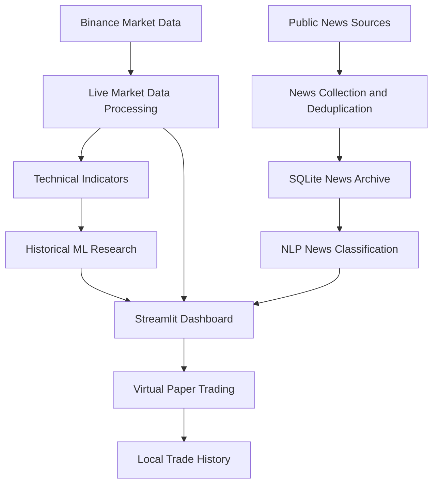

# XRP Market Intelligence Dashboard

A real-time XRP/USDT market intelligence dashboard combining **Machine Learning, Natural Language Processing (NLP), Technical Analysis, Live News Intelligence, and Paper Trading Simulation**.

> **Disclaimer:** This project is developed for educational and data science research purposes only. It does not execute real trades or provide verified financial predictions.

## Project Overview

XRP Market Intelligence is a Python-based data science project designed to analyze cryptocurrency market behavior using historical and live market data.

The system integrates machine learning models, technical indicators, and AI-assisted news classification into an interactive Streamlit dashboard.

The main objective is to explore how data science, machine learning, and NLP can support financial market research.

### Project Objectives

- Collect and visualize real-time XRP market data.
- Analyze historical cryptocurrency price movements.
- Calculate and interpret technical indicators.
- Classify XRP-related news using NLP.
- Investigate short-term price movement patterns.
- Evaluate machine learning models against baseline approaches.
- Simulate virtual trading outcomes.
- Build an interactive dashboard for market research.

## Key Features

### 1. Real-Time XRP Market Dashboard

- Live XRP/USDT price monitoring.
- Binance API and WebSocket integration.
- 24-hour price change, high, low, and volume.
- Interactive price charts.
- Multiple chart timeframes:
  - 1 minute
  - 5 minutes
  - 15 minutes
  - 1 hour
- Data freshness monitoring.
- Automatic reconnection and fallback handling.

### 2. Technical Analysis

The dashboard provides technical indicators, including:

| Indicator | Purpose |
|---|---|
| RSI | Measures price momentum |
| EMA | Identifies moving price trends |
| MACD | Examines momentum and trend changes |
| Trading Volume | Measures trading activity |
| Volume Spikes | Highlights unusual trading activity |

These indicators support research and visualization. They do not guarantee future price movements.

### 3. Live XRP News Intelligence

The system collects XRP-related articles from configured public news sources.

Features include:

- Automatic news polling approximately every five minutes while the application is running.
- Manual news refresh.
- Duplicate article prevention.
- Persistent SQLite news storage.
- Source-status monitoring.
- Publication and collection timestamps.
- Sri Lankan time display (SLST).
- Stale-news warnings.
- Automatic provisional news classification.

News availability depends on publisher feeds, network connectivity, and source restrictions.

### 4. AI-Assisted News Classification

The NLP system categorizes news into four research classes:

| Classification | Description |
|---|---|
| Real_Adoption | News concerning XRP adoption and real-world integrations |
| Hype_Speculation | Speculative claims, rumors, and promotional headlines |
| Negative_FUD | Negative or uncertainty-related market news |
| Neutral_Market_News | General market information |

The project includes:

- TF-IDF feature extraction.
- Logistic Regression classification.
- Experimental transformer-based workflows.
- Human-reviewed and AI-provisional label separation.
- News data collection and research pipelines.

AI-generated labels are provisional and should not be interpreted as verified facts.

### 5. Experimental One-Hour Trend Analysis

The project investigates XRP market direction over the next hour using historical market information.

The experimental model uses three classes:

- UP
- DOWN
- NEUTRAL

Model development includes:

- Historical candle collection.
- Feature engineering.
- Chronological evaluation.
- Baseline comparisons.
- Model performance reporting.

#### Historical Experiment Results

| Evaluation Metric | Reported Accuracy |
|---|---:|
| Experimental ML Model | 44.26% |
| Majority-Class Baseline | 41.90% |
| Technical-Rules Baseline | 32.69% |

These are historical development results and have not been independently reproduced for the latest repository commit.

**Important:** The model has not demonstrated reliable predictive performance. Its outputs are experimental research labels, not verified trading signals or calibrated probabilities.

### 6. Historical Market Research

The project contains research workflows for:

- Historical XRP/USDT data collection.
- Data cleaning and preprocessing.
- Feature generation.
- Market condition analysis.
- Chronological model evaluation.
- Historical outcome comparisons.
- Experimental one-hour and 24-hour trend studies.

The one-hour and 24-hour research pipelines are separate experiments and should not be interpreted as equivalent forecasts.

### 7. Paper Trading Simulator

The dashboard includes a virtual trading environment for educational testing.

Features include:

- Starting virtual balance of 100 USDT.
- Simulated XRP spot positions.
- Virtual position opening and closing.
- Configurable trading fees.
- Simulated slippage.
- Virtual profit and loss calculations.
- Persistent local trade history.
- Model-signal comparison.

**No real money, exchange orders, or cryptocurrency wallets are involved.**

## Technology Stack

| Category | Technologies |
|---|---|
| Programming Language | Python |
| Dashboard | Streamlit |
| Data Processing | pandas, NumPy |
| Machine Learning | scikit-learn |
| NLP | TF-IDF, Logistic Regression |
| Experimental ML | Logistic Regression, Random Forest, HistGradientBoosting |
| Visualization | Plotly |
| Market Data | Binance Public API, WebSocket |
| News Collection | Public RSS feeds |
| Database | SQLite |
| Version Control | Git, GitHub |
| Testing | pytest |

See `requirements.txt` for the actual project dependencies.

## System Architecture



This diagram represents the main components conceptually. Individual research workflows may use additional scripts and datasets.

## Project Structure

The repository contains the following main files:

```text
XRP-Market-Intelligence/
|
|-- app.py
|-- model.py
|-- live_data.py
|-- streaming_market.py
|-- live_market_ui.py
|
|-- live_news.py
|-- live_news_sources.py
|-- live_news_ui.py
|
|-- one_hour_trend.py
|-- one_hour_ui.py
|-- train_one_hour.py
|
|-- paper_trading.py
|-- paper_trading_ui.py
|
|-- collect_real_news.py
|-- collect_multisource_news.py
|-- research_workflow.py
|-- review_research_app.py
|
|-- data/
|-- artifacts/
|-- tests/
|
|-- requirements.txt
|-- requirements-bert.txt
|-- .env.example
|-- .gitignore
|-- README.md
```

Some generated research datasets, trained models, and local database files are intentionally excluded from GitHub.

## Installation Guide

### Prerequisites

- Windows 11 or another compatible operating system.
- Python 3.13 (used during local development).
- Git.
- Visual Studio Code or another Python IDE.
- Internet access for public market and news feeds.

### Step 1: Clone the Repository

```powershell
git clone https://github.com/ineshjayawardhana/XRP-Market-Intelligence.git
cd XRP-Market-Intelligence
```

### Step 2: Create a Virtual Environment

```powershell
py -3.13 -m venv .venv
```

Activate the environment:

```powershell
.\.venv\Scripts\Activate.ps1
```

### Step 3: Install Dependencies

```powershell
python -m pip install --upgrade pip
python -m pip install -r requirements.txt
```

### Step 4: Configure Optional Environment Variables

Review `.env.example`.

Create a local `.env` file only if a configured news source or optional feature requires credentials.

Never upload real API keys, passwords, or tokens to GitHub.

### Step 5: Start the Main Dashboard

```powershell
python -m streamlit run app.py --server.port 8501
```

Open:

http://localhost:8501

Press `Ctrl + C` in the terminal to stop the application.

### Optional: Start the News Research Review App

```powershell
python -m streamlit run review_research_app.py --server.port 8502
```

Open:

http://localhost:8502

Some research features require datasets or model artifacts that are generated locally and not included in the repository.

Opening the dashboard does not automatically retrain the models.

## Research Methodology

The project follows an experimental data science workflow:

1. Data collection from market and news sources.
2. Data cleaning and validation.
3. Exploratory data analysis.
4. Technical feature engineering.
5. NLP-based news categorization.
6. Machine learning model development.
7. Chronological evaluation and baseline comparison.
8. Visualization and interpretation.
9. Virtual paper trading observations.

### NLP Research

The initial NLP baseline uses 200 synthetic teaching headlines.

Synthetic training performance should not be treated as real-world news classification accuracy.

Additional workflows collect genuine published news and maintain separate human-reviewed and AI-provisional labels.

### Historical Evaluation

The project examines historical XRP price movements and compares experimental models against baseline approaches.

The older 24-hour research uses the following outcome definitions:

- UP: return greater than or equal to +1%.
- DOWN: return less than or equal to -1%.
- NEUTRAL: otherwise.

The more recent one-hour model is a separate research experiment.

Historical results do not guarantee future performance.

## Timezone Management

The dashboard displays timestamps using:

**Asia/Colombo (UTC+05:30)**

Internally, market data and research timestamps use UTC where appropriate.

This separation helps maintain consistent historical calculations and readable local timestamps.

## Testing

The project contains automated tests for its main research and dashboard components.

Run:

```powershell
python -m pytest -q
```

A previous local development report recorded 262 passing tests after an update to the news pipeline.

This is a historical development result. The current repository version should be tested again before claiming the same result.

## Data Sources and Limitations

- Public market data can be delayed or unavailable.
- News feeds can fail, change, or impose rate limits.
- News publication times and collection times are not necessarily identical.
- News classification does not establish whether a claim is true.
- Historical model accuracy may not generalize to new market conditions.
- Experimental direction labels are not guaranteed forecasts.
- Paper trading results are simulated and may differ from real-world outcomes.
- Some locally generated files are intentionally excluded from version control.

Third-party datasets and article content should only be redistributed where permitted.

## Future Improvements

Potential research improvements include:

- Larger verified real-news datasets.
- More robust chronological and forward-period validation.
- Improved model calibration.
- Detailed performance monitoring.
- Expanded explainable machine learning analysis.
- Better experimental reporting and reproducibility.
- Improved interactive dashboard documentation.

## Additional Documentation

- [Market Intelligence](MARKET_INTELLIGENCE_README.md)
- [Live News](LIVE_NEWS_README.md)
- [One-Hour Research](ONE_HOUR_RESEARCH_README.md)
- [24-Hour Trend Research](TREND_RESEARCH_README.md)
- [Paper Trading](PAPER_TRADING_README.md)
- [Research Review](RESEARCH_REVIEW_README.md)
- [Multi-Source News](MULTISOURCE_NEWS_README.md)

## Project Status

**Active Data Science Research Project**

The project continues to evolve through market-data analysis, NLP research, experimental machine learning, and dashboard development.

## Disclaimer

This software is intended for educational research and demonstration.

It is not a financial advisory service, an automated trading system, or a source of verified price predictions.

All paper-trading activity uses simulated funds.

---

**Developed as a personal Data Science and Machine Learning project.**
